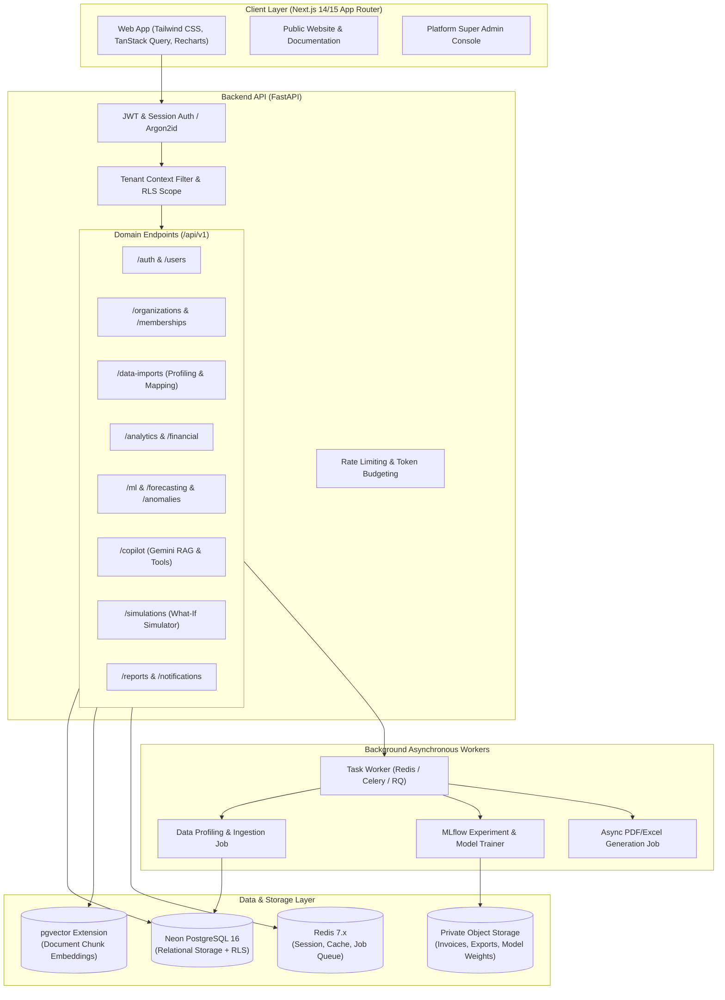

# MarginPilot AI — System Architecture & Technical Specification

## 1. Executive Summary & Product Vision

**MarginPilot AI** is an enterprise-grade AI Business Intelligence & Decision Automation Platform designed as an intelligent operating system for retail, manufacturing, wholesale, and distribution businesses.

Unlike generic chatbots or static business dashboards, MarginPilot AI is architected on a foundational principle: **Every insight, forecast, and recommendation is generated from real, auditable business data via dedicated ML pipelines, deep learning models, and securely grounded generative AI tools.**

```
+-------------------------------------------------------------------------------------------------------+
|                                           MARGINPILOT AI                                              |
|                                                                                                       |
|  +--------------------+  +--------------------+  +--------------------+  +-------------------------+  |
|  |       Retail       |  |   Manufacturing    |  |     Wholesale      |  |      Distribution       |  |
|  | POS, Stores, Promo |  |  BOM, Defect, OEE  |  | Bulk, Tiered Price |  | Warehouses, Fleet, Lead|  |
|  +---------+----------+  +---------+----------+  +---------+----------+  +------------+------------+  |
|            |                       |                       |                          |               |
|            +-----------------------+-----------------------+--------------------------+               |
|                                                |                                                      |
|                                v-------------------------------v                                      |
|                                |   Canonical Business Schema   |                                      |
|                                +---------------+---------------+                                      |
|                                                |                                                      |
|         +--------------------------------------+--------------------------------------+               |
|         |                                      |                                      |               |
|         v                                      v                                      v               |
|  +--------------+                      +---------------+                      +---------------+       |
|  |  Analytics   |                      |  ML & Deep    |                      |   Gemini AI   |       |
|  |    Engine    |                      |  Learning     |                      |    Copilot    |       |
|  | Aggregations |                      | Forecasting & |                      | Grounded RAG  |       |
|  |  KPI Trends  |                      | Anomaly Det.  |                      | Tool Calling  |       |
|  +--------------+                      +---------------+                      +---------------+       |
+-------------------------------------------------------------------------------------------------------+
```

---

## 2. Logical Architecture & Layering

The system adopts a **modular monolith** architecture designed with strict domain boundaries and clear interfaces. This avoids premature microservice overhead while enabling future service extraction (e.g., dedicated GPU inference workers or streaming ingestion).



---

## 3. Multi-Tenant Architecture & Data Isolation

Multi-tenancy is enforced through multiple defensive layers:

1. **Mandatory Tenant Discriminator Column**: Every organization-scoped relational table strictly contains an `organization_id: UUID` column (with composite foreign keys and tenant-prefixed indices).
2. **FastAPI Dependency Injection**: Every protected route resolves `get_current_tenant_context()`, which extracts and verifies the user's active organization membership and role permissions before touching the database session.
3. **Database-Level Isolation**:
   - Connection-scoped tenant configuration: `SET LOCAL app.current_organization_id = '<uuid>';`
   - Row-Level Security (RLS) policies on critical business tables preventing any query execution outside the tenant boundary even in cases of application logic flaws.
4. **Automated Cross-Tenant Access Verification**: Comprehensive test suites deliberately attempt cross-tenant ID substitution on all CRUD and analytical endpoints, asserting HTTP 403/404 denial.

---

## 4. Canonical Business Data Schema

To support Retail, Manufacturing, Wholesale, and Distribution without data divergence, MarginPilot AI defines a normalized Canonical Business Model:

- **Identity & Tenancy**: Users, Organizations, Memberships, Invitations, AuditLogs.
- **Master Data**: Customers, Suppliers, Products, ProductCategories, Warehouses.
- **Sales & Distribution**: SalesOrders, SalesOrderItems, Shipments, Deliveries, Returns.
- **Procurement & Inventory**: PurchaseOrders, PurchaseOrderItems, InventoryTransactions, ReorderRules.
- **Manufacturing Extensions**: ProductionOrders, ProductionBatches, BillOfMaterials (BOM), RawMaterials, Machines, SensorReadings.
- **Financial & Accounting**: Invoices, InvoiceItems, Payments, Expenses.
- **Intelligence & AI Artifacts**: MLModelVersions, Predictions, Anomalies, Recommendations, DocumentEmbeddings, CopilotConversations, CopilotMessages.

---

## 5. Machine Learning & Deep Learning Pipelines

### 5.1 Machine Learning Engine
- **Customer Segmentation**: RFM feature engineering + K-Means clustering with Silhouette score validation and DBSCAN fallback.
- **Churn Prediction**: Supervised gradient boosted decision trees (XGBoost / LightGBM) trained on rolling behavioral windows, with SHAP attribution for explainability.
- **Customer Lifetime Value (CLV)**: Supervised XGBoost regression with Gamma-Gamma / BG-NBD probabilistic validation.
- **Demand Forecasting**: Hierarchical multi-horizon demand forecasting (7, 30, 90 days) utilizing LightGBM / XGBoost with lag, calendar, and lead-time features.
- **Anomaly Detection**: Unsupervised Isolation Forest and statistical Z-score/IQR thresholds for transactions, margins, and inventory fluctuations.

### 5.2 Deep Learning Pipelines (PyTorch)
- **Time-Series Forecasting**: Multi-layer LSTM networks with sequence-to-sequence encoder-decoder architecture, tracking validation RMSE and comparing against seasonal naive baselines.
- **Reconstruction Anomaly Detection**: Deep Autoencoder neural networks measuring reconstruction loss on numerical business transactions to capture non-linear irregularities.
- **Semantic Vector Embeddings**: Sentence Transformers (`all-MiniLM-L6-v2`) generating dense vector representations stored in `pgvector` for semantic document retrieval.

### 5.3 MLOps & Governance
- **Tracking & Registry**: MLflow integrated for logging parameters, artifact weights, metrics, and dataset hashes.
- **Model Promotion Lifecycle**: `Development` -> `Evaluation` -> `Staging` -> `Production` -> `Archived`.
- **Governance**: Active models are only deployed if evaluation metrics beat established baselines.

---

## 6. Generative AI Business Copilot & RAG Architecture

```
User Query: "Why did gross profit drop in Q3?"
       |
       v
+-------------------------------------------------------+
| 1. Query Analyzer & Sanitizer (Injection Guardrails)  |
+-------------------------------------------------------+
       |
       v
+-------------------------------------------------------+
| 2. Controlled Server-Side Tool Calling Execution      |
|    - get_sales_summary(date_range)                    |
|    - get_profit_summary(date_range)                   |
|    - pgvector semantic chunk search                   |
+-------------------------------------------------------+
       |
       v
+-------------------------------------------------------+
| 3. Verified Structured Context Assembly               |
|    (Exact verified numbers, SQL metrics, chunk refs)  |
+-------------------------------------------------------+
       |
       v
+-------------------------------------------------------+
| 4. Gemini 1.5 Pro / Flash Inference                   |
|    System Prompt: Grounded, no unverified assertions  |
+-------------------------------------------------------+
       |
       v
Structured Grounded Answer with Citations, Metrics & Limitations
```

---

## 7. Security & Compliance Posture

- **Cryptographic Hashing**: Argon2id password hashing with custom salt.
- **Session & Tokens**: JWT tokens signed with asymmetric or high-entropy HS256 secret keys, short expiration, and refresh token rotation.
- **Zero Raw Document Exposure**: Uploaded files validated by MIME magic bytes and scanned, stored in private object storage, never executed or served unsanitized.
- **SQL Execution Safety**: Zero dynamic SQL strings from user or LLM input; all database access is mediated by parameterized SQLAlchemy statements with strict query templates.
