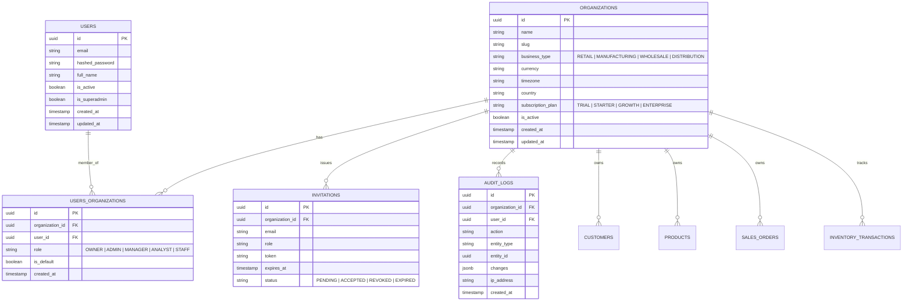

# MarginPilot AI — Canonical Database Schema Specification

This document defines the canonical relational database schema for MarginPilot AI. Built for **PostgreSQL 16+** with **pgvector**, with full support for SQLite during local unit and cross-tenant tests.

---

## 1. Tenancy, Identity & Access Control

---

## 2. Master Business Entities

### `customers`
- `id: UUID (PK)`
- `organization_id: UUID (FK -> organizations.id, INDEXED)`
- `customer_code: VARCHAR(64)`
- `name: VARCHAR(255)`
- `email: VARCHAR(255)`
- `phone: VARCHAR(64)`
- `segment: VARCHAR(64)` (e.g. VIP, Regular, At-Risk, New)
- `clv_estimate: NUMERIC(14, 2)`
- `churn_risk_score: NUMERIC(5, 4)` (0.0000 - 1.0000)
- `created_at: TIMESTAMP`, `updated_at: TIMESTAMP`

### `suppliers`
- `id: UUID (PK)`
- `organization_id: UUID (FK -> organizations.id, INDEXED)`
- `supplier_code: VARCHAR(64)`
- `name: VARCHAR(255)`
- `contact_email: VARCHAR(255)`
- `avg_lead_time_days: NUMERIC(6, 2)`
- `on_time_delivery_rate: NUMERIC(5, 4)`
- `reliability_score: NUMERIC(5, 4)`
- `created_at: TIMESTAMP`, `updated_at: TIMESTAMP`

### `product_categories`
- `id: UUID (PK)`
- `organization_id: UUID (FK -> organizations.id, INDEXED)`
- `name: VARCHAR(128)`
- `code: VARCHAR(64)`
- `description: TEXT`

### `products`
- `id: UUID (PK)`
- `organization_id: UUID (FK -> organizations.id, INDEXED)`
- `category_id: UUID (FK -> product_categories.id, NULLABLE)`
- `sku: VARCHAR(64)`
- `name: VARCHAR(255)`
- `description: TEXT`
- `cost_price: NUMERIC(14, 2)`
- `selling_price: NUMERIC(14, 2)`
- `reorder_point: INTEGER`
- `safety_stock: INTEGER`
- `lead_time_days: INTEGER`
- `is_active: BOOLEAN`
- `created_at: TIMESTAMP`, `updated_at: TIMESTAMP`

### `warehouses`
- `id: UUID (PK)`
- `organization_id: UUID (FK -> organizations.id, INDEXED)`
- `code: VARCHAR(64)`
- `name: VARCHAR(255)`
- `location: VARCHAR(255)`
- `capacity: NUMERIC(12, 2)`

---

## 3. Commercial & Transactional Data

### `sales_orders`
- `id: UUID (PK)`
- `organization_id: UUID (FK -> organizations.id, INDEXED)`
- `customer_id: UUID (FK -> customers.id, INDEXED)`
- `order_number: VARCHAR(64) UNIQUE per tenant`
- `order_date: TIMESTAMP (INDEXED)`
- `status: VARCHAR(32)` (PENDING, CONFIRMED, SHIPPED, DELIVERED, CANCELLED)
- `subtotal: NUMERIC(14, 2)`
- `tax_amount: NUMERIC(14, 2)`
- `discount_amount: NUMERIC(14, 2)`
- `total_amount: NUMERIC(14, 2)`
- `cogs_amount: NUMERIC(14, 2)`
- `gross_profit: NUMERIC(14, 2)`
- `created_at: TIMESTAMP`

### `sales_order_items`
- `id: UUID (PK)`
- `organization_id: UUID (FK -> organizations.id, INDEXED)`
- `sales_order_id: UUID (FK -> sales_orders.id, INDEXED)`
- `product_id: UUID (FK -> products.id, INDEXED)`
- `quantity: NUMERIC(12, 4)`
- `unit_cost: NUMERIC(14, 2)`
- `unit_price: NUMERIC(14, 2)`
- `discount: NUMERIC(14, 2)`
- `line_total: NUMERIC(14, 2)`

### `inventory_transactions`
- `id: UUID (PK)`
- `organization_id: UUID (FK -> organizations.id, INDEXED)`
- `product_id: UUID (FK -> products.id, INDEXED)`
- `warehouse_id: UUID (FK -> warehouses.id, INDEXED)`
- `transaction_type: VARCHAR(32)` (PURCHASE_RECEIPT, SALE_ISSUE, ADJUSTMENT, RETURN, TRANSFER)
- `quantity: NUMERIC(12, 4)` (signed)
- `unit_cost: NUMERIC(14, 2)`
- `reference_id: UUID` (e.g., sales_order_id or purchase_order_id)
- `transaction_date: TIMESTAMP (INDEXED)`

---

## 4. Machine Learning & AI Schema

### `ml_model_versions`
- `id: UUID (PK)`
- `organization_id: UUID (FK -> organizations.id, NULLABLE for global baselines)`
- `model_name: VARCHAR(128)` (e.g., `customer_churn_xgb`, `demand_forecast_lgbm`)
- `version: VARCHAR(32)`
- `model_type: VARCHAR(64)` (XGBOOST, LIGHTGBM, PYTORCH_LSTM, AUTOENCODER, KMEANS)
- `metrics: JSONB` (e.g. `{"accuracy": 0.914, "f1": 0.902, "mape": 0.087}`)
- `parameters: JSONB`
- `artifact_uri: VARCHAR(512)`
- `status: VARCHAR(32)` (DEVELOPMENT, STAGING, PRODUCTION, ARCHIVED)
- `created_at: TIMESTAMP`

### `ml_predictions`
- `id: UUID (PK)`
- `organization_id: UUID (FK -> organizations.id, INDEXED)`
- `model_version_id: UUID (FK -> ml_model_versions.id)`
- `target_entity_type: VARCHAR(64)` (CUSTOMER, PRODUCT, ORDER)
- `target_entity_id: UUID`
- `predicted_value: JSONB`
- `confidence_score: NUMERIC(5, 4)`
- `explainability: JSONB` (SHAP values / top contributing factors)
- `created_at: TIMESTAMP`

### `anomalies`
- `id: UUID (PK)`
- `organization_id: UUID (FK -> organizations.id, INDEXED)`
- `entity_type: VARCHAR(64)` (TRANSACTION, EXPENSE, INVENTORY, MARGIN)
- `entity_id: UUID`
- `severity: VARCHAR(16)` (LOW, MEDIUM, HIGH, CRITICAL)
- `detected_value: NUMERIC(14, 2)`
- `expected_range: JSONB`
- `explanation: TEXT`
- `status: VARCHAR(32)` (OPEN, INVESTIGATING, RESOLVED, FALSE_POSITIVE)
- `created_at: TIMESTAMP`

### `recommendations`
- `id: UUID (PK)`
- `organization_id: UUID (FK -> organizations.id, INDEXED)`
- `category: VARCHAR(64)` (INVENTORY_REORDER, CHURN_PREVENTION, MARGIN_OPTIMIZATION, SUPPLIER_REVIEW)
- `title: VARCHAR(255)`
- `description: TEXT`
- `supporting_evidence: JSONB`
- `expected_impact: VARCHAR(255)`
- `priority: VARCHAR(16)` (LOW, MEDIUM, HIGH)
- `status: VARCHAR(32)` (PENDING, ACCEPTED, REJECTED, COMPLETED)
- `created_at: TIMESTAMP`

### `copilot_conversations` & `copilot_messages`
- Stored session context, token counts, grounded tool calls executed, and assistant responses.
- Grounded tool outputs and source document citations are preserved for verifiable auditability.
