# MarginPilot AI — Development Roadmap & Phased Execution Plan

This document establishes the step-by-step phased engineering roadmap for **MarginPilot AI**. In accordance with strict software engineering standards, development is executed phase by phase, validating each milestone with automated tests before advancing.

---

## Roadmap Overview

```mermaid
flowchart LR
    P1["Phase 1: Foundation\n(Auth, Multi-Tenancy, Shell)"] --> P2["Phase 2: Data Platform\n(Ingestion, Profiling, Mapping)"]
    P2 --> P3["Phase 3: Business Intelligence\n(Analytics, KPIs, SQL Engine)"]
    P3 --> P4["Phase 4: ML Platform\n(XGBoost, RFM, Churn, Forecast)"]
    P4 --> P5["Phase 5: Deep Learning\n(LSTM, Autoencoders, Embeddings)"]
    P5 --> P6["Phase 6: Gemini Copilot\n(RAG, Tool Calling, Grounding)"]
    P6 --> P7["Phase 7: Decision Engine\n(What-If Sim, Recommendations)"]
    P7 --> P8["Phase 8: Production\n(Monitoring, MLOps, Deploy)"]
```

---

## Detailed Phase Breakdown

### Phase 1: Project Foundation & Multi-Tenant Core (CURRENT PHASE)
- [x] Repository topology setup (`frontend/`, `backend/`, `ml_engine/`, `docs/`).
- [x] Comprehensive architectural design, canonical schema, and security specifications.
- [ ] Backend foundation:
  - FastAPI asynchronous application with structured routers.
  - SQLAlchemy 2.0 ORM with PostgreSQL / SQLite support for local dev & CI.
  - Multi-tenant data model with explicit `organization_id` foreign keys.
  - Argon2id password hashing + JWT access/refresh token generation.
  - Role-Based Access Control (RBAC): SuperAdmin, Owner, Admin, Manager, Analyst, Staff.
  - Workspace switching without re-authentication.
  - Audit logging middleware for sensitive operations.
- [ ] Frontend foundation:
  - Next.js 14/15 App Router with Tailwind CSS, Lucide Icons, and TypeScript.
  - Enterprise layout matching design mockups (Sidebar, Topbar with Org Switcher, Metric cards).
  - Authentication flow (Sign In, Sign Up, Org Onboarding, Workspace Switcher).
  - State management using TanStack Query and Context API.
- [ ] Testing & Verification:
  - Pytest unit tests for authentication, password hashing, and token validation.
  - Automated cross-tenant isolation attack test (verifying Organization A cannot read/mutate Organization B's data).
  - Health check endpoints (`/health`, `/ready`).

---

### Phase 2: Data Ingestion & Intelligent Mapping Engine (COMPLETED)
- [x] Canonical data ingestion pipeline (CSV, XLSX, JSON).
- [x] Statistical data profiling (row counts, nulls, cardinality, type inference).
- [x] Intelligent column-mapping engine with heuristic and alias matching.
- [x] Validation suite (orphan keys, negative quantities, date formats, anomalous prices).
- [x] Interactive mapping review and commit UI with idempotent import logs.

---

### Phase 3: Business Intelligence & Analytics Engine (NEXT PHASE)
- [ ] Core metrics layer (Net Sales, COGS, Gross Profit, Gross Margin, AOV, Turnover).
- [ ] SQL-aggregated analytical endpoints with date-range filters (7d, 30d, 90d, custom).
- [ ] Comparative analytics (Period-over-Period, Category breakdown, Segment drill-downs).
- [ ] Interactive Recharts visualizations: Revenue Trends, Margin Analysis, Inventory Alerts.

---

### Phase 4: Machine Learning Platform & Classical ML Models
- [ ] Feature store and feature engineering pipelines.
- [ ] Customer Segmentation: RFM feature calculation + K-Means clustering with Silhouette score.
- [ ] Churn Prediction: XGBoost classification with configurable inactivity windows and SHAP feature importances.
- [ ] Demand Forecasting: Multi-horizon (7/30/90 days) LightGBM models with lag and calendar features.
- [ ] Financial Anomaly Detection: Isolation Forest identifying abnormal expenses and margin drops.
- [ ] MLflow experiment tracking and model artifact persistence.

---

### Phase 5: Deep Learning Engine (PyTorch)
- [ ] PyTorch LSTM time-series demand forecasting with sequence windowing.
- [ ] PyTorch Deep Autoencoder for high-dimensional transaction reconstruction anomalies.
- [ ] Transformer embeddings using `sentence-transformers` for semantic document indexing in `pgvector`.
- [ ] Quantitative model comparison: Baseline vs. XGBoost vs. LSTM benchmarks.

---

### Phase 6: Gemini AI Business Copilot & RAG
- [ ] Google Gemini API integration with server-side API key isolation.
- [ ] Controlled database query tools (Sales summary, Inventory status, Anomaly breakdown).
- [ ] Document ingestion, chunking, and semantic vector similarity search via `pgvector`.
- [ ] Grounded business response generator with exact citations and verified metrics.
- [ ] Anti-prompt-injection sanitization and tenant-scoped retrieval guardrails.

---

### Phase 7: What-If Decision Simulator & Actionable Recommendations
- [ ] Interactive scenario simulation engine (Price elasticity, Supplier cost spikes, Demand shifts).
- [ ] Scenario comparison (Baseline vs. Best-Case vs. Expected vs. Worst-Case).
- [ ] Evidence-backed AI Recommendation Engine with human approval lifecycle (`Pending` -> `Accepted` -> `Completed`).
- [ ] Document OCR & financial entity extraction (Invoices, Receipts) with human review screen.

---

### Phase 8: Production Readiness, Security Hardening & Deployment
- [ ] Super Admin console: Organization metrics, model health, job monitoring, audit trail.
- [ ] Rate limiting, CORS policies, secure HTTP-only cookies, and CSRF protection.
- [ ] Production build and configuration for Vercel (Frontend) and Render (FastAPI + Worker).
- [ ] Neon PostgreSQL migration runs and Redis connection pooling.
- [ ] Complete documentation package verification and release tag.
