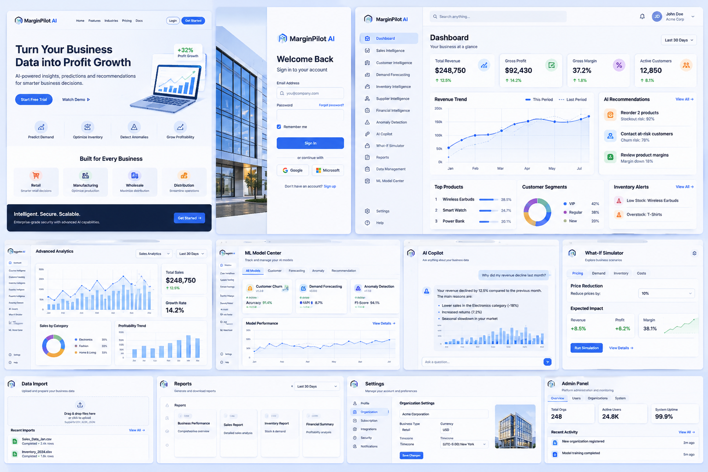

# MarginPilot AI
### Enterprise AI Business Intelligence & Decision Automation Platform

MarginPilot AI is a production-oriented, multi-tenant SaaS platform that helps retail, manufacturing, wholesale, and distribution businesses understand operations, forecast demand, detect anomalies, simulate strategic decisions, and optimize profitability using verified business data.



---
    
## Key Pillars

- **Real Data Foundation**: Canonical business data schema supporting Retail, Manufacturing, Wholesale, and Distribution without artificial data or mock metrics.
- **Trained Machine Learning & Deep Learning**: Scikit-Learn, XGBoost, LightGBM, and PyTorch models for Demand Forecasting, Churn Risk, CLV, Customer Segmentation, and Reconstruction Anomalies.
- **Grounded AI Copilot**: Google Gemini API integration with server-side tool calling and RAG via `pgvector`. Every answer using business numbers is backed by validated database queries.
- **Enterprise Multi-Tenancy**: Organization-level data isolation, Row-Level Security, Argon2id encryption, RBAC, and automated cross-tenant security verification.
- **Modern Clean UI**: Next.js App Router, Tailwind CSS, TanStack Query, Recharts, and Lucide icons following light-first enterprise design principles.

---

## Technology Stack

- **Frontend**: Next.js (App Router), React, TypeScript, Tailwind CSS, Recharts, TanStack Query, React Hook Form, Zod, Lucide React.
- **Backend**: Python 3.12+, FastAPI, Pydantic v2, SQLAlchemy 2.x, Alembic, Argon2id, PyJWT.
- **Databases**: Neon PostgreSQL (with `pgvector`), Redis for caching & job coordination, SQLite for lightweight zero-dependency local testing.
- **Machine Learning**: Scikit-learn, XGBoost, LightGBM, PyTorch (LSTM & Autoencoders), SHAP, MLflow.
- **AI & RAG**: Google Gemini API, Sentence Transformers, pgvector.

---

## Repository Structure

```
MARGINPILOT-AI/
├── frontend/                  # Next.js 14/15 App Router Frontend
│   ├── app/                   # App routes (Auth, Dashboard, Intelligence, Settings)
│   ├── components/            # Reusable UI & layout components
│   └── lib/                   # API clients, Auth context, utilities
├── backend/                   # FastAPI Backend Services
│   ├── app/
│   │   ├── api/v1/            # REST API endpoints & route handlers
│   │   ├── core/              # Config, Security, Multi-tenant context
│   │   ├── db/                # SQLAlchemy session, base model, seeds
│   │   ├── models/            # Canonical business database models
│   │   ├── schemas/           # Pydantic v2 request/response schemas
│   │   └── services/          # Business logic & repository services
│   ├── alembic/               # Database migrations
│   └── tests/                 # Pytest unit & cross-tenant security tests
├── ml_engine/                 # Trainable ML & Deep Learning pipelines
├── docs/                      # Complete specifications & documentation
│   ├── ARCHITECTURE.md
│   ├── DATABASE_SCHEMA.md
│   ├── DEVELOPMENT_ROADMAP.md
│   ├── SECURITY.md
│   └── ENVIRONMENT_VARIABLES.md
└── README.md
```

---

## Implementation & Phase Execution Status

- [x] **Phase 1: Project Foundation & Multi-Tenant Core**: Argon2id password hashing, JWT tenant switching, RBAC (Owner, Admin, Manager, Analyst, Staff), Next.js app shell matching design mockup.
- [x] **Phase 2: Canonical Business Data Platform & Ingestion**: Statistical profiling, fuzzy column mapping, transactional data importer with rollback support, and 4-step import wizard.
- [x] **Phase 3: Business Intelligence & Analytics Engine**: Verified database aggregations, period-over-period growth rates, AOV, Gross Margin %, sales by category, and stockout surveillance.
- [x] **Phase 4: Machine Learning Platform & Classical ML**: Trainable RFM K-Means segmentation, Random Forest churn classifier with explainable risk factors, HistGradientBoosting multi-horizon SKU demand forecaster, and Isolation Forest transaction anomaly detection.
- [x] **Phase 5: Deep Learning Engine (PyTorch)**: Native 2-layer PyTorch LSTM multi-horizon forecaster ($7d, 30d, 90d$), Deep Symmetric Autoencoder with reconstruction loss anomaly thresholding, and comparative ML benchmark matrix.
- [x] **Phase 6: Gemini AI Business Copilot & Grounded RAG**: Server-side tool execution (`google-genai`), anti-hallucination database grounding, conversation history persistence, and interactive chat interface with inline Recharts visualization.
- [x] **Phase 7: What-If Decision Simulator & AI Recommendations**: Price elasticity scenario simulation, demand surge and cost shock modeling, canonical recommendations engine (`Reorder products`, `Contact at-risk customers`, `Review product margins`), and executive reporting suite.
- [x] **Phase 8: Production Hardening, Settings & Super Admin Platform**: Organization settings management, Super Admin overview telemetry, automated cross-tenant security verification, 26/26 passing pytest suite, and 20/20 clean static frontend routes.


---

## Local Setup & Development

### 1. Backend Setup
```bash
cd backend
python -m venv .venv
# On Windows:
.venv\Scripts\activate
# On Linux/macOS:
source .venv/bin/activate

pip install -r requirements.txt
pytest
uvicorn app.main:app --reload --port 8000
```

### 2. Frontend Setup
```bash
cd frontend
npm install
npm run dev
```

Visit `http://localhost:3000` to access the application.
